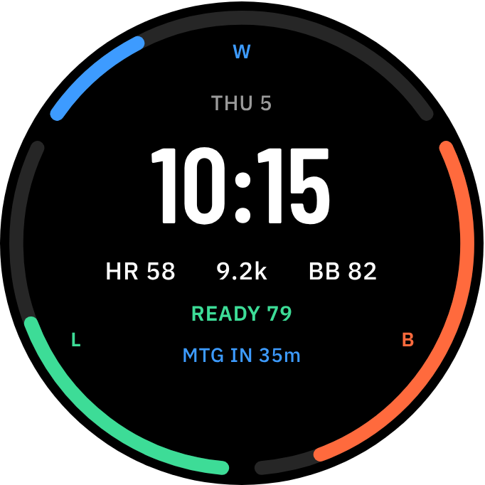

# Trinity

A Garmin Connect IQ watch face for the Forerunner 265 (also 265S and 965) that balances **WORK · BODY · LIFE**,
with a **READY** score at the core (sleep, Body Battery, stress, recovery time) that raises or lowers the day's targets.

The design brief with the research, device capabilities, scoring model and an interactive simulator is in `docs/trinity-brief.html`.

**Continuing later?** Start with [`docs/SESSION_NOTES.md`](docs/SESSION_NOTES.md): the original request, decisions made, open questions, research sources and next steps.



## What is here

| Path | What it is | Status |
|---|---|---|
| `manifest.xml`, `monkey.jungle` | Connect IQ project (watch face, min API 4.2.0) | Not yet compiled |
| `source/Metrics.mc` | Reads HR, steps, calories, intensity minutes, Body Battery, stress, sleep score, recovery time, next calendar event | Not yet compiled |
| `source/Scoring.mc` | READY, BODY, WORK and LIFE formulas | Not yet compiled |
| `source/Nudge.mc` | One-line guidance, priority ordered | Not yet compiled |
| `source/TrinityView.mc` | Face rendering, AMOLED always-on mode | Not yet compiled |
| `source/TrinityApp.mc`, `source/TrinityBridgeService.mc` | App entry and the 15-minute background calendar fetch | Not yet compiled |
| `resources/` | Strings, user settings (goals, work hours, Bridge URL), launcher icon | — |
| `bridge/google-apps-script/Code.gs` | Calendar Bridge: returns categories and minutes only, never titles | Logic tested |
| `tools/test_bridge.js` | Tests for the Bridge's categorising and summarising | Passing |
| `tools/screenshot_brief.js` | Renders the brief and saves face screenshots for each scenario | Working |
| `docs/SESSION_NOTES.md` | Handoff: request, decisions, open questions, sources, next steps | — |
| `docs/screenshots/` | Brief and simulated face for four scenarios | Current |

## Build and run

1. Create a Garmin developer account and install the Connect IQ SDK Manager. Download the SDK and the `fr265` device.
2. Install the Monkey C extension for VS Code, then run **Monkey C: Generate a Developer Key**.
3. Open this folder and run **Monkey C: Run** with `fr265` selected. The simulator's Data menu lets you set Body Battery, stress, steps, and so on.
4. To put it on your own watch: **Monkey C: Build for Device**, then copy the `.prg` to `GARMIN/APPS/` on the watch over USB.

Test the Bridge logic:

```bash
node tools/test_bridge.js
```

## Things to verify on first build

- The format of the native calendar complication string (`"2:30p"` vs `"14:30"`). `Metrics.minutesUntil` handles both and falls back to showing the raw text.
- That the estimated active calories track Garmin Connect's number within about 10%.
- Font sizes and positions on the 416 px and 360 px screens.
- That Google Apps Script's redirect works with `makeWebRequest` through Garmin Connect Mobile. If it does not, host the same logic on a small Cloudflare Worker.
